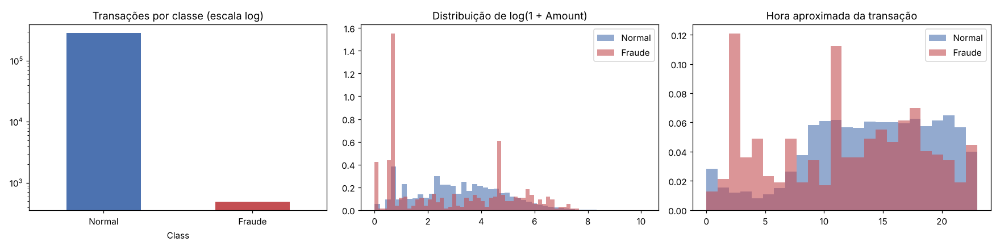
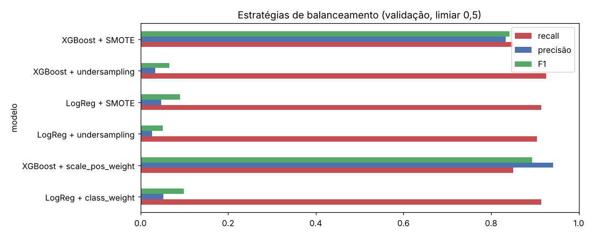
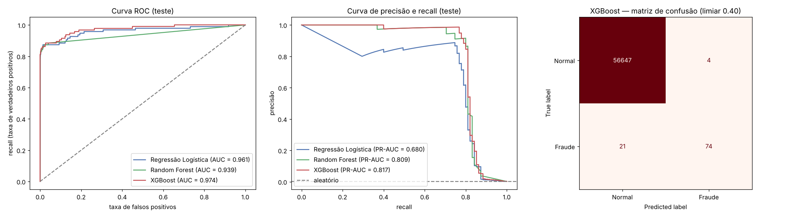
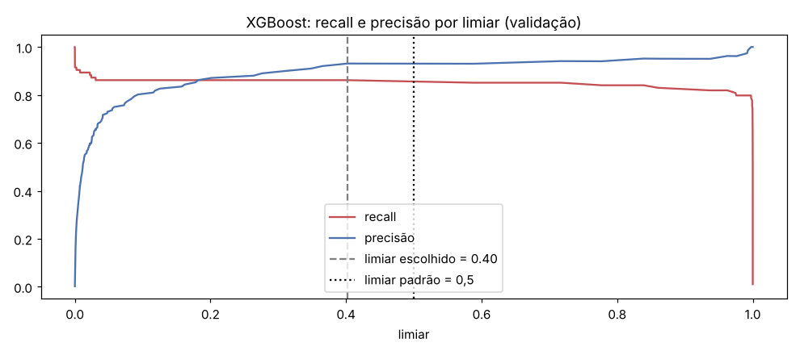
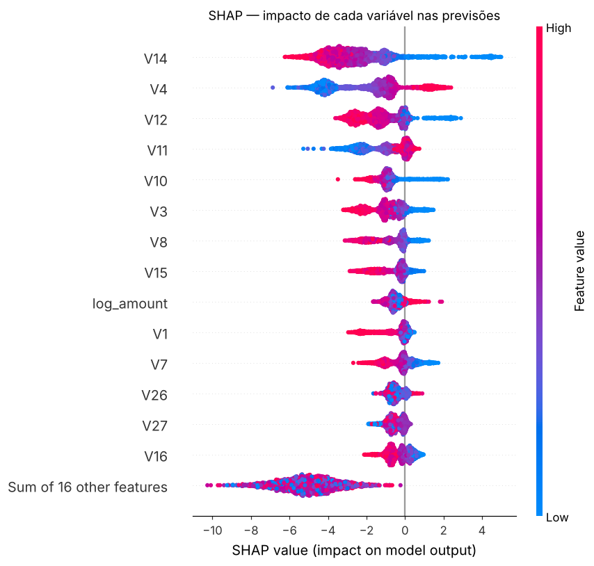
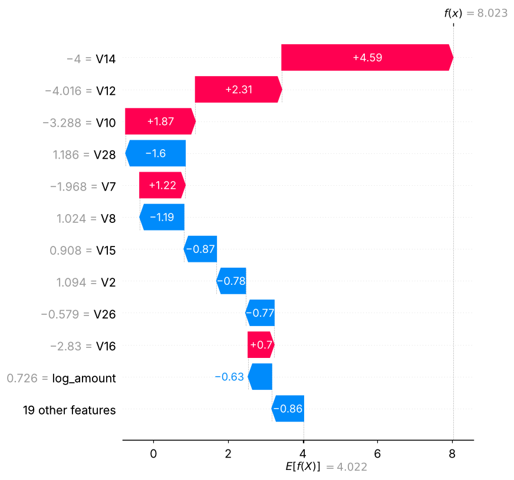

# Detecção de Fraude em Cartão de Crédito

Projeto de machine learning para detectar fraudes em transações reais de cartão de crédito, cobrindo todo o caminho: exploração, preparação, comparação de modelos, ajuste do limiar de decisão e explicação das previsões com SHAP.

📓 **Notebook:** [`fraude_cartao.ipynb`](fraude_cartao.ipynb). Todas as saídas (tabelas e gráficos) estão salvas.

---

## 1. O problema

A base tem **284.807 transações** feitas por cartões europeus em dois dias de setembro de 2013. Ela traz as colunas `Time`, `Amount` e `Class`, além de `V1` a `V28`, que foram transformadas por PCA para proteger a privacidade dos clientes.

Só **492 transações (0,17%) são fraude**.



### Por que a acurácia engana

Um "modelo" que responde **sempre "não é fraude"** tem **99,83% de acurácia** e não detecta nenhuma fraude. Neste problema, a acurácia mede basicamente a proporção da classe majoritária. Por isso, a avaliação é feita **só na classe fraude**:

| Métrica | Pergunta que responde |
|---|---|
| **Recall** (métrica principal) | De todas as fraudes reais, quantas o modelo pegou? |
| **Precisão** | De todos os alertas do modelo, quantos eram fraude de verdade? |
| **F1** | Equilíbrio entre recall e precisão |
| **PR-AUC** | Qualidade geral do modelo em todos os limiares, mais informativa que a ROC-AUC com dados desbalanceados |

## 2. Preparação dos dados

- Remoção de **1.081 linhas duplicadas**.
- **Novas variáveis:**
  - `log_amount = log(1 + Amount)`, porque o valor é muito assimétrico;
  - `hora`, a hora aproximada do dia calculada a partir de `Time`.
- Divisão **estratificada** (`stratify=y`) em **treino (60%)**, **validação (20%)** e **teste (20%)**. A proporção de fraudes ficou em cerca de 0,17% nos três conjuntos.
- `StandardScaler` **ajustado só no treino**, para evitar vazamento de dados.
- Undersampling e SMOTE aplicados **dentro de um `Pipeline` do imblearn**, ou seja, só no treino. Validação e teste mantêm a proporção real de fraudes.

## 3. Comparação dos modelos

### 3.1 Tratamento do desbalanceamento (validação, limiar 0,5)

| Modelo | Recall | Precisão | F1 | PR-AUC | Alarmes falsos |
|---|---|---|---|---|---|
| Regressão Logística (sem tratamento) | 0,681 | 0,889 | 0,771 | 0,798 | 8 |
| Regressão Logística + `class_weight` | 0,915 | 0,052 | 0,099 | 0,790 | 1.554 |
| Regressão Logística + undersampling | 0,904 | 0,026 | 0,051 | 0,466 | 3.134 |
| Regressão Logística + SMOTE | 0,915 | 0,048 | 0,091 | 0,791 | 1.714 |
| Random Forest + `class_weight` | 0,819 | 0,917 | 0,865 | 0,878 | 7 |
| **XGBoost + `scale_pos_weight`** | **0,851** | **0,941** | **0,894** | **0,882** | **5** |
| XGBoost + undersampling | 0,926 | 0,034 | 0,066 | 0,574 | 2.453 |
| XGBoost + SMOTE | 0,851 | 0,833 | 0,842 | 0,871 | 16 |



**Conclusões:**

- **Undersampling** aumenta o recall, mas descarta quase todas as transações normais e gera milhares de alarmes falsos.
- **SMOTE** não superou o peso das classes.
- O **XGBoost com `scale_pos_weight`** teve o melhor equilíbrio e a maior PR-AUC.

Ele foi ajustado com `GridSearchCV`, usando validação cruzada estratificada de 3 folds e PR-AUC (`average_precision`) como critério. Os melhores parâmetros foram `max_depth=4`, `n_estimators=400` e `subsample=0.8`.

### 3.2 Resultado final no conjunto de teste

O teste não participou de nenhuma escolha de hiperparâmetro ou de limiar.

| Modelo | Limiar | Recall | Precisão | F1 | PR-AUC | Fraudes detectadas | Alarmes falsos |
|---|---|---|---|---|---|---|---|
| Regressão Logística | 0,5 | 0,874 | 0,050 | 0,094 | 0,680 | 83/95 | 1.591 |
| Regressão Logística | ajustado (0,9998) | 0,768 | 0,777 | 0,773 | 0,680 | 73/95 | 21 |
| Random Forest | 0,5 | 0,705 | 0,971 | 0,817 | 0,809 | 67/95 | 2 |
| Random Forest | ajustado (0,246) | 0,758 | 0,911 | 0,828 | 0,809 | 72/95 | 7 |
| XGBoost | 0,5 | 0,768 | 0,948 | 0,849 | 0,817 | 73/95 | 4 |
| **XGBoost** | **ajustado (0,402)** | **0,779** | **0,949** | **0,856** | **0,817** | **74/95** | **4** |

A tabela completa está em [`resultados/comparacao_modelos_teste.csv`](resultados/comparacao_modelos_teste.csv).



Na **curva ROC**, os três modelos parecem quase iguais (AUC entre 0,94 e 0,97). Já a **curva de precisão e recall** mostra a diferença real: a Regressão Logística perde precisão muito antes dos modelos de árvore.

## 4. Limiar de decisão

O limiar padrão de 0,5 não é obrigatório. Como **deixar passar uma fraude custa mais do que investigar um alarme falso**, o limiar foi escolhido para **maximizar o F2 na validação**. O F2 dá o dobro de peso ao recall em relação à precisão.

- **Limiar escolhido para o XGBoost: 0,40.** No teste, ele detectou **74 de 95 fraudes**, com só **4 alarmes falsos** entre 56.651 transações normais.



O ajuste do limiar também foi aplicado ao Random Forest e à Regressão Logística. Na Regressão Logística ele fez a maior diferença: os alarmes falsos caíram de 1.591 para 21.

O limiar é uma decisão de negócio. Baixar o limiar do XGBoost no teste mostra o custo de pegar mais fraudes:

| Limiar | Recall | Precisão | Fraudes detectadas | Alarmes falsos |
|---|---|---|---|---|
| 0,90 | 0,747 | 0,986 | 71/95 | 1 |
| 0,40 | 0,779 | 0,949 | 74/95 | 4 |
| 0,10 | 0,811 | 0,837 | 77/95 | 15 |
| 0,02 | 0,811 | 0,597 | 77/95 | 52 |
| 0,005 | 0,821 | 0,355 | 78/95 | 142 |

## 5. O que o SHAP mostrou



- As variáveis que mais pesam são **`V14`, `V4`, `V12`, `V11` e `V10`**.
- Valores **baixos** de `V14`, `V12`, `V10` e `V3` e valores **altos** de `V4` e `V11` empurram a previsão para fraude.
- `log_amount` tem influência menor que as variáveis do PCA.

**Por que esta transação foi marcada como fraude?** No exemplo abaixo, o modelo deu probabilidade de 0,9997. Os maiores responsáveis foram `V14 = -4,0`, `V12 = -4,0` e `V10 = -3,3`.



**E as fraudes que escaparam?** Nas 21 fraudes não detectadas, os valores dessas variáveis ficam próximos dos de transações normais. A mediana de `V14`, por exemplo, é -0,97 nessas fraudes, contra -7,3 nas fraudes detectadas e 0,06 nas transações normais. Elas "se disfarçam" de transação comum.

## 6. O que mudei em relação à Expert

> ✏️ *Revise esta seção comparando com o que foi feito nas aulas.*

- Separei um **conjunto de validação**, usado para escolher o limiar. Assim, o teste só é usado na avaliação final e não influencia nenhuma decisão.
- Escolhi o limiar pelo **F2**, que prioriza o recall, em vez de usar o limiar padrão de 0,5.
- Levei o **Random Forest para o ajuste de limiar**, junto com a Regressão Logística e o XGBoost.
- Comparei **peso das classes, undersampling e SMOTE** em dois modelos diferentes, com o resampling dentro de um `Pipeline`.
- Usei **PR-AUC como critério do `GridSearchCV`**, em vez da acurácia.
- Analisei com SHAP também uma **fraude que o modelo não pegou**, além de uma detectada.

## 7. Limitações e próximos passos

- Com só 95 fraudes no teste, cada fraude vale cerca de 1 ponto percentual de recall, então os números variam com a divisão dos dados.
- A base não tem identificador de cartão nem de cliente, o que impede criar variáveis de comportamento ao longo do tempo, como transações em sequência do mesmo cartão.
- Um próximo passo seria escolher o limiar com custos reais: o valor médio de uma fraude contra o custo de investigar um alerta.

## Como rodar

**Google Colab:** abra o notebook, descomente a linha `!pip install` da primeira célula de código e clique em *Executar tudo*.

**Localmente:**

```bash
python -m venv .venv
.venv\Scripts\activate          # Windows  (Linux/Mac: source .venv/bin/activate)
pip install -r requirements.txt
jupyter notebook fraude_cartao.ipynb
```

O dataset (cerca de 100 MB) é baixado direto pelo link dentro do notebook e **não fica no repositório**. Na máquina usada, a execução completa leva cerca de 5 minutos.

## Estrutura

```
├── fraude_cartao.ipynb            # notebook completo, com saídas
├── README.md
├── requirements.txt
├── imagens/                       # gráficos gerados pelo notebook
└── resultados/
    └── comparacao_modelos_teste.csv
```

**Fonte dos dados:** *Credit Card Fraud Detection*, Machine Learning Group, ULB (Kaggle).
